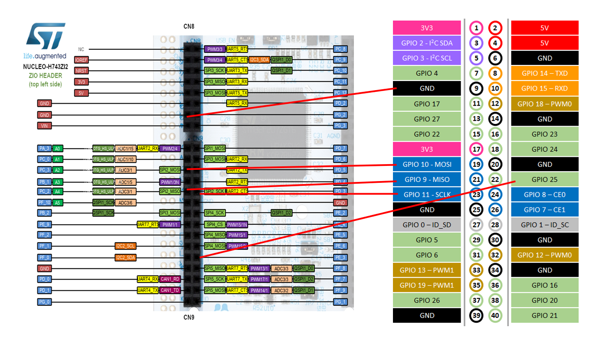
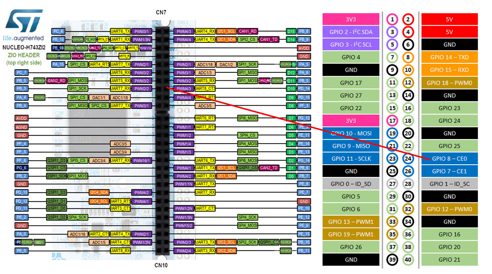

1. `gpio25_interrupt_test.cpp`
   → **只驗證 CM5 GPIO25 rising-edge interrupt / notification**

2. `spi_master_16byte_test.cpp`
   → **只驗證 CM5 SPI Master 能不能透過 `/dev/spidev0.0` 取得 STM32 SPI Slave 的 16-byte 資料**

3. `spi_master_irq_16byte_test.cpp`
   → **把前兩個驗證整合起來：GPIO25 notification → SPI transaction → sequence verification**
   → 這就是目前正式的 **16-byte IRQ-triggered SPI baseline**
   → 以下說明針對此檔案。
   → 編譯與執行方法在最後面。

---

# Raspberry Pi CM5 SPI Master Test

## STM32H755 SPI2 Slave + PE3 Notification + CM5 GPIO25 Interrupt

---

## 1. Project Overview

本專案用於驗證：

> **Raspberry Pi CM5 作為 SPI Master，接收 STM32H755 SPI2 Slave 傳送的資料。**

目前的硬體架構為：

```text
STM32H755 CM7
     │
     │ SPI2 Slave
     │
     ├──────── SPI SCK ───────────────► CM5 SPI Master
     ├──────── SPI MOSI ──────────────► CM5 SPI Master
     ├──────── SPI MISO ◄────────────── CM5 SPI Master
     ├──────── SPI CS  ◄─────────────── CM5 CE0
     │
     │ PE3
     │
     └──────────────► CM5 GPIO25
                       │
                       │ Rising Edge
                       ▼
                  GPIO Interrupt
                       │
                       ▼
                  SPI Transfer
                       │
                       ▼
                  RX Data
                       │
                       ▼
                 Data Verify
```

目前已經完成第一階段：

```text
16-byte
IRQ-triggered
SPI Mode 0
1 MHz
STM32 SPI2 Slave
CM5 SPI Master
Sequence verification
```

並且已經實際 PASS。

---

# 2. Project Purpose

這個專案不是最終的 EtherCAT application。

目前的目的，是在正式接入 EtherCAT real data 之前，先把：

```text
GPIO notification
        +
SPI Master
        +
SPI Slave
        +
Data integrity
        +
Sequence verification
```

逐項驗證完成。

最終目標是：

```text
STM32H755
    │
    │ 每 1 ms 產生一筆 EtherCAT data
    │
    │ 204 Bytes
    ▼
SPI2 Slave
    │
    ▼
CM5 GPIO25 notification
    │
    ▼
CM5 SPI Master
    │
    ▼
204-byte RX
    │
    ▼
Sequence verification
```

最終必須確認：

* packet 不遺失
* packet 不重複
* packet 不錯序
* data 不錯位
* data 不損壞
* 長時間運作穩定

---

# 3. Related STM32 Project

CM5 端程式對應的 STM32 專案：

```text
STM32_SlaveSPI2_RPi5_MasterSPI
```

STM32 使用：

```text
STM32H755ZIT6U
NUCLEO-H755ZI-Q
```

STM32 執行：

```text
SPI2 = Slave
```

CM5 執行：

```text
SPI = Master
```

---

# 4. Hardware Connection

## 4.1 SPI Connection

目前 STM32H755 SPI2 與 Raspberry Pi CM5 的連接如下。

| Signal               | STM32H755      | Raspberry Pi CM5 |
| -------------------- | -------------- | ---------------- |
| SPI Clock            | SPI2_SCK       | GPIO11 / SCLK    |
| SPI Data STM32 → CM5 | SPI2_MISO      | GPIO9 / MISO     |
| SPI Data CM5 → STM32 | SPI2_MOSI      | GPIO10 / MOSI    |
| SPI Chip Select      | PD14 / SPI2_CS | GPIO8 / CE0      |
| Notification         | PE3            | GPIO25           |
| Ground               | GND            | GND              |

也就是：

```text
STM32H755                         Raspberry Pi CM5
──────────                         ────────────────

SPI2_SCK      ──────────────────► GPIO11 / SCLK

SPI2_MISO     ──────────────────► GPIO9 / MISO

SPI2_MOSI     ◄────────────────── GPIO10 / MOSI

PD14 / CS     ◄────────────────── GPIO8 / CE0

PE3           ──────────────────► GPIO25

GND           ─────────────────── GND
```

### 非常重要

STM32 是：

```text
SPI Slave
```

CM5 是：

```text
SPI Master
```

所以：

> **SPI clock 是由 CM5 Master 產生，不是 STM32 產生。**

CM5 收到 PE3 notification 後，才啟動 SPI transaction。

---

# 5. PE3 Notification

STM32 使用：

```text
PE3
```

通知 CM5：

> STM32 已經準備好一筆 SPI data。

CM5 使用：

```text
GPIO25
```

接收這個 notification。

目前 CM5 設定：

```text
GPIO chip : /dev/gpiochip0
GPIO line : 25
Edge      : RISING
```

因此：

```text
STM32 PE3

LOW
 │
 │
 └────── HIGH
          │
          ▼
     CM5 GPIO25
          │
          ▼
    RISING EDGE
          │
          ▼
   C++ program wakes
          │
          ▼
     SPI transfer
```

---

# 6. Why GPIO25 Is Used

SPI 本身只負責：

```text
SCK
MOSI
MISO
CS
```

SPI 並不知道：

> 「STM32 現在是不是已經準備好下一個 packet？」

因此額外使用 PE3/GPIO25 作為：

```text
DATA READY / NOTIFICATION
```

目前的定義是：

```text
PE3 rising edge
=
STM32 有一筆 data 可以讓 CM5 讀取
```

---

# 7. SPI Configuration

目前測試設定：

```text
SPI device : /dev/spidev0.0
SPI mode   : 0
SPI speed  : 1,000,000 Hz
bits       : 8
```

也就是：

```text
Mode 0
CPOL = 0
CPHA = 0
```

CM5 C++ 程式使用：

```cpp
SPI_IOC_MESSAGE(1)
```

執行 SPI transaction。

---

# 8. Directory Structure

目前資料夾：

```text
spi-master-test/
```

包含：

```text
spi-master-test/
│
├── gpio25_interrupt_test.cpp
├── spi_master_16byte_test.cpp
├── spi_master_irq_16byte_test.cpp
│
└── README.md
```

三個程式並不是三份重複程式。

它們代表 SPI bring-up 的三個不同階段。

---

# 9. gpio25_interrupt_test.cpp

## Purpose

這是最早期的 GPIO notification 測試程式。

主要目的：

> **單獨確認 STM32 PE3 → CM5 GPIO25 的硬體 notification 是否正常。**

此程式不負責完整 SPI data transfer。

它主要驗證：

```text
STM32 PE3
    │
    ▼
CM5 GPIO25
    │
    ▼
Rising Edge Detection
    │
    ▼
C++ program
```

---

## GPIO Configuration

使用：

```text
/dev/gpiochip0
```

GPIO：

```text
GPIO25
```

edge：

```text
RISING
```

因此 STM32：

```text
PE3 LOW → HIGH
```

CM5 應該收到：

```text
GPIO25 RISING
```

---

## Why This Test Exists

在 SPI 測試之前，必須先確定 notification 本身是正常的。

否則如果後面的 SPI 測試失敗，就無法判斷問題來自：

```text
GPIO
```

還是：

```text
SPI
```

因此先把 GPIO notification 單獨驗證。

---

# 10. spi_master_16byte_test.cpp

## Purpose

第二個測試程式用來驗證：

> **CM5 SPI Master 能否透過 `/dev/spidev0.0` 與 STM32 SPI2 Slave 完成 16-byte transaction。**

這個測試的重點是 SPI 本身。

基本流程：

```text
CM5
 │
 │ SPI Master transaction
 ▼
STM32 SPI2 Slave
 │
 │ 16 bytes
 ▼
CM5 RX buffer
 │
 ▼
Data verification
```

---

## Difference From GPIO Test

這個程式主要驗證：

```text
SPI Master
   ↓
SPI Slave
   ↓
16-byte RX
```

而不是：

```text
GPIO interrupt
```

因此它可以把：

```text
GPIO notification
```

與：

```text
SPI transfer
```

兩個問題分開。

---

# 11. spi_master_irq_16byte_test.cpp

這是目前最重要的測試程式。

它將前面兩個測試整合成完整流程：

```text
PE3 notification
       ↓
GPIO25 RISING
       ↓
C++ program wake-up
       ↓
SPI Master transaction
       ↓
STM32 SPI2 Slave
       ↓
16-byte RX
       ↓
Sequence verification
       ↓
Statistics
```

這也是目前 GitHub 應該標記為：

> **Current validated 16-byte baseline**

的程式。

---

# 12. spi_master_irq_16byte_test.cpp Configuration

目前：

```cpp
static constexpr const char* GPIO_CHIP = "/dev/gpiochip0";

static constexpr unsigned int GPIO_LINE = 25;

static constexpr const char* SPI_DEVICE =
    "/dev/spidev0.0";

static constexpr uint8_t SPI_MODE =
    SPI_MODE_0;

static constexpr uint32_t SPI_SPEED_HZ =
    1000000U;

static constexpr uint8_t SPI_BITS_PER_WORD =
    8U;

static constexpr size_t TEST_DATA_SIZE =
    16U;
```

因此：

```text
GPIO       : 25
SPI device : /dev/spidev0.0
SPI mode   : 0
SPI clock  : 1 MHz
bits       : 8
RX         : 16 bytes
```

---

# 13. Main Test Flow

程式啟動後：

```text
1. Open /dev/gpiochip0
        ↓
2. Configure GPIO25
        ↓
3. Rising edge detection
        ↓
4. Open /dev/spidev0.0
        ↓
5. Configure SPI Mode 0
        ↓
6. Configure 1 MHz
        ↓
7. Wait for PE3
```

程式會停在：

```text
Waiting for STM32H755 PE3...
```

此時沒有 GPIO event 就不會執行 SPI transaction。

---

# 14. GPIO Event

當 STM32：

```text
PE3 LOW → HIGH
```

CM5 收到：

```text
GPIO25 RISING
```

例如：

```text
[10:19:21] GPIO25 RISING  IRQ=1
```

此時：

```text
irq_count++
```

然後才啟動 SPI。

---

# 15. SPI Transaction

GPIO interrupt 發生後：

```text
[SPI] Starting Master transaction...
```

CM5 呼叫：

```cpp
spi.Transfer(...)
```

建立：

```cpp
struct spi_ioc_transfer
```

並執行：

```cpp
ioctl(
    fd_,
    SPI_IOC_MESSAGE(1),
    &transfer);
```

完成 16-byte SPI transfer。

---

# 16. RX Data

STM32 目前傳送：

```text
Sequence Number
Reserved
01
02
03
...
0E
```

例如第一筆：

```text
00 00 01 02 03 04 05 06
07 08 09 0A 0B 0C 0D 0E
```

第二筆：

```text
01 00 01 02 03 04 05 06
07 08 09 0A 0B 0C 0D 0E
```

第三筆：

```text
02 00 01 02 03 04 05 06
07 08 09 0A 0B 0C 0D 0E
```

---

# 17. Sequence Number

目前 Byte 0 是：

```text
Sequence Number
```

目的不是 EtherCAT protocol。

它是為了驗證：

> **SPI data 是否遺失、重複或順序錯誤。**

例如正常：

```text
0
1
2
3
4
5
```

代表：

```text
No missing
No duplicate
No out-of-order
```

---

# 18. Sequence Verification

CM5 會保存：

```text
expected sequence
```

如果：

```text
expected = 5
received = 5
```

則：

```text
PASS
```

如果：

```text
expected = 5
received = 6
```

則：

```text
missing packet
```

如果：

```text
expected = 5
received = 4
```

則可能是：

```text
duplicate
```

或：

```text
out-of-order
```

---

# 19. Statistics

目前程式會顯示：

```text
IRQ
SPI
PASS
FAIL
SEQ_ERR
MISSING
DUP/OOO
```

例如：

```text
[STAT] IRQ=4 SPI=4 PASS=4 FAIL=0
       SEQ_ERR=0 MISSING=0 DUP/OOO=0
```

這些 counter 是後續 204-byte / 1-ms 測試非常重要的診斷資訊。

---

# 20. Meaning of Counters

## IRQ

CM5 收到多少次：

```text
GPIO25 RISING
```

例如：

```text
IRQ=1000
```

代表 CM5 收到 1000 次 notification event。

---

## SPI

實際成功執行多少次：

```text
SPI transfer
```

理想狀態：

```text
IRQ == SPI
```

---

## PASS

SPI data verification 成功次數。

理想：

```text
PASS == SPI
```

---

## FAIL

SPI transfer 或 data verification 發生錯誤的次數。

理想：

```text
FAIL = 0
```

---

## SEQ_ERR

sequence verification 發生錯誤的次數。

理想：

```text
SEQ_ERR = 0
```

---

## MISSING

sequence 顯示有 packet 遺失。

理想：

```text
MISSING = 0
```

---

## DUP/OOO

Duplicate / Out-of-order。

理想：

```text
DUP/OOO = 0
```

---

# 21. Current Validated Result

目前最新的測試結果：

```text
herman@RPiCM5:~/spi-master-test $ ./spi_master_irq_16byte_test
========================================
CM5 SPI Master + GPIO25 Interrupt Test
========================================
GPIO chip : /dev/gpiochip0
GPIO line : 25
Edge      : RISING
SPI device: /dev/spidev0.0
SPI mode  : 0
SPI speed : 1000000 Hz
RX size   : 16 bytes
========================================
[SPI] Device       : /dev/spidev0.0
[SPI] Mode         : 0
[SPI] Bits         : 8
[SPI] Speed        : 1000000 Hz
[TEST] Expected RX : 00 00 01 02 03 04 05 06 07 08 09 0A 0B 0C 0D 0E
========================================
Waiting for STM32H755 PE3...
========================================
```

第一筆：

```text
[10:19:21] GPIO25 RISING  IRQ=1
[SPI] Starting Master transaction...
[SPI] RX data : 00 00 01 02 03 04 05 06 07 08 09 0A 0B 0C 0D 0E
[SEQ] Received=0
[VERIFY] PASS
[STAT] IRQ=1 SPI=1 PASS=1 FAIL=0 SEQ_ERR=0 MISSING=0 DUP/OOO=0
```

第二筆：

```text
[10:19:22] GPIO25 RISING  IRQ=2
[SPI] Starting Master transaction...
[SPI] RX data : 01 00 01 02 03 04 05 06 07 08 09 0A 0B 0C 0D 0E
[SEQ] Received=1
[VERIFY] PASS
[STAT] IRQ=2 SPI=2 PASS=2 FAIL=0 SEQ_ERR=0 MISSING=0 DUP/OOO=0
```

第三筆：

```text
[10:19:22] GPIO25 RISING  IRQ=3
[SPI] Starting Master transaction...
[SPI] RX data : 02 00 01 02 03 04 05 06 07 08 09 0A 0B 0C 0D 0E
[SEQ] Received=2
[VERIFY] PASS
[STAT] IRQ=3 SPI=3 PASS=3 FAIL=0 SEQ_ERR=0 MISSING=0 DUP/OOO=0
```

第四筆：

```text
[10:19:23] GPIO25 RISING  IRQ=4
[SPI] Starting Master transaction...
[SPI] RX data : 03 00 01 02 03 04 05 06 07 08 09 0A 0B 0C 0D 0E
[SEQ] Received=3
[VERIFY] PASS
[STAT] IRQ=4 SPI=4 PASS=4 FAIL=0 SEQ_ERR=0 MISSING=0 DUP/OOO=0
```

這代表：

```text
IRQ = 4
SPI = 4
PASS = 4
FAIL = 0
SEQ_ERR = 0
MISSING = 0
DUP/OOO = 0
```

---

# 22. Important Startup Synchronization Finding

早期測試曾經發生：

```text
SEQ=0
```

被 CM5 收到兩次。

現象：

```text
IRQ=1
SEQ=0
PASS

IRQ=2
SEQ=0
DUPLICATE / OUT-OF-ORDER
```

之後才：

```text
SEQ=1
SEQ=2
SEQ=3
...
```

這表示 STM32 與 CM5 在啟動時存在 synchronization timing 問題。

後續在 STM32 啟動測試前加入 startup delay 後，問題消失。

目前結果：

```text
SEQ=0
SEQ=1
SEQ=2
SEQ=3
...
```

連續正常。

因此 startup synchronization 是後續高頻率測試必須持續注意的項目。

---

# 23. Important: Current Test Is Not Yet 204-byte / 1-ms Validation

目前測試：

```text
Data size : 16 bytes
SPI       : 1 MHz
```

這是：

> **Bring-up baseline**

不是最終系統。

目前尚未證明：

```text
204 bytes
+
1 ms
+
1000 packets/sec
```

可以長時間零遺失運作。

---

# 24. 204-byte Timing Consideration

如果仍使用：

```text
SPI = 1 MHz
```

傳送 204 bytes：

```text
204 × 8
=
1632 bits
```

所需時間：

```text
1632 / 1,000,000
=
1.632 ms
```

因此：

```text
1 MHz
+
204 bytes
+
1 ms period
```

無法直接滿足最終 timing requirement。

所以進入 204-byte 測試後，需要逐步提高 SPI clock，並重新驗證：

```text
SPI transfer
GPIO notification
sequence
packet loss
```

---

# 25. Planned Test Phases

目前規劃：

```text
Phase 1
GPIO25 interrupt
        ↓
PASS
```

↓

```text
Phase 2
SPI Master 16-byte
        ↓
PASS
```

↓

```text
Phase 3
GPIO25 IRQ
        ↓
SPI Master
        ↓
16-byte
        ↓
Sequence verification
        ↓
PASS
```

目前已完成。

接下來：

```text
Phase 4
204-byte
low frequency
```

↓

```text
Phase 5
increase SPI clock
```

↓

```text
Phase 6
increase notification frequency
```

↓

```text
Phase 7
1 ms / 204 bytes
```

↓

```text
Phase 8
long-duration test
```

↓

```text
Phase 9
real EtherCAT data
```

---

# 26. Final Data Path

最終希望形成：

```text
                    STM32H755 CM7
                         │
                         │ EtherCAT data
                         │
                         ▼
                    204-byte packet
                         │
                         ▼
                     SPI2 Slave
                         │
                         │
                    PE3 HIGH
                         │
                         ▼
                  CM5 GPIO25 IRQ
                         │
                         ▼
                  SPI Master Start
                         │
                         ▼
                    204-byte RX
                         │
                         ▼
                   Sequence Check
                         │
              ┌──────────┼──────────┐
              ▼          ▼          ▼
            PASS       NO LOSS    IN ORDER
```

---

# 27. Data Integrity Requirements

正式測試時必須同時滿足：

```text
IRQ count
    =
SPI count
```

並且：

```text
SPI count
    =
PASS count
```

以及：

```text
SEQ_ERR = 0
MISSING = 0
DUP/OOO = 0
```

長時間測試也必須保持這些條件。

---

# 28. Build / Run

目前主要執行程式：

```text
spi_master_irq_16byte_test
```

執行：

```bash
./spi_master_irq_16byte_test
```

啟動後應看到：

```text
Waiting for STM32H755 PE3...
```

接著啟動或 reset STM32H755。

當 PE3：

```text
LOW → HIGH
```

CM5 應看到：

```text
GPIO25 RISING
```

然後：

```text
SPI transaction
```

最後：

```text
VERIFY PASS
```

---

# 29. Current Baseline

目前 GitHub 建議將：

```text
spi_master_irq_16byte_test.cpp
```

視為：

> **16-byte IRQ-triggered SPI validated baseline**

這個版本已經實際驗證：

```text
STM32 PE3
      ↓
CM5 GPIO25
      ↓
GPIO rising event
      ↓
SPI Master
      ↓
STM32 SPI2 Slave
      ↓
16-byte RX
      ↓
Sequence verification
      ↓
PASS
```

---

# 30. Development Rule

後續修改必須遵守：

> **不要破壞目前已知 PASS 的 16-byte baseline。**

每一次修改：

1. 只修改必要部分
2. 編譯
3. 執行
4. 確認結果
5. 比較 counter
6. 再進入下一階段

尤其進入：

```text
204 bytes
1 ms
```

之後，不能只看：

```text
PASS
```

還必須看：

```text
IRQ
SPI
PASS
FAIL
SEQ_ERR
MISSING
DUP/OOO
```

---

# 31. Current Status

| Test Item                   | Status      |
| --------------------------- | ----------- |
| GPIO25 input                | PASS        |
| GPIO25 rising edge          | PASS        |
| STM32 PE3 notification      | PASS        |
| SPI device `/dev/spidev0.0` | PASS        |
| SPI Mode 0                  | PASS        |
| SPI 1 MHz                   | PASS        |
| 16-byte SPI transfer        | PASS        |
| STM32 SPI2 Slave            | PASS        |
| CM5 SPI Master              | PASS        |
| RX data verification        | PASS        |
| Sequence verification       | PASS        |
| Missing packet detection    | Implemented |
| Duplicate/OoO detection     | Implemented |
| 204-byte transfer           | Pending     |
| High-frequency transfer     | Pending     |
| 1-ms / 204-byte             | Pending     |
| Long-duration test          | Pending     |
| Real EtherCAT data          | Pending     |

---

# 32. Conclusion

`spi-master-test` 是 STM32H755 SPI2 Slave bring-up 的 **Raspberry Pi CM5 Master 端測試專案**。

三個測試程式各自負責不同階段：

```text
gpio25_interrupt_test.cpp
        │
        ▼
GPIO notification validation


spi_master_16byte_test.cpp
        │
        ▼
SPI Master / Slave validation


spi_master_irq_16byte_test.cpp
        │
        ▼
GPIO notification
      +
SPI transfer
      +
Sequence verification
      +
Data integrity validation
```

目前第三個程式已經完成第一個完整 baseline：

```text
16-byte
SPI Mode 0
1 MHz
PE3 → GPIO25
IRQ-triggered SPI
Sequence verification
```

最新驗證結果：

```text
IRQ=4
SPI=4
PASS=4
FAIL=0
SEQ_ERR=0
MISSING=0
DUP/OOO=0
```

因此目前已確認：

> **CM5 可以等待 STM32H755 PE3 notification，在收到 GPIO25 rising edge 後，以 SPI Master 模式啟動 transaction，從 STM32H755 SPI2 Slave 正確取得 16-byte 資料，並透過 sequence number 驗證資料連續性。**

這個版本應作為後續：

```text
16 Byte
   ↓
204 Byte
   ↓
higher SPI clock
   ↓
high frequency
   ↓
1 ms
   ↓
EtherCAT real data
```

的基準版本。

# 編譯與執行
## 編譯

```bash
cd ~/spi-master-test

g++ -std=c++17 -Wall -Wextra -O2 \
    gpio25_interrupt_test.cpp \
    -lgpiodcxx -lgpiod \
    -o gpio25_interrupt_test
```

```bash
cd ~/spi-master-test

g++ -std=c++17 -Wall -Wextra -O2 \
    spi_master_16byte_test.cpp \
    -o spi_master_16byte_test
```

**主要程式**
```bash
cd ~/spi-master-test

g++ -std=c++17 -Wall -Wextra -O2 \
    spi_master_irq_16byte_test.cpp \
    -lgpiodcxx -lgpiod \
    -o spi_master_irq_16byte_test 
```

## 執行

```bash
cd ~/spi-master-test

./gpio25_interrupt_test  

./spi_master_16byte_test

./spi_master_irq_16byte_test   <<< 主要程式
```

# 硬體連接圖





# 更新版本
## [2026-08-25] 修改檔案 spi_master_irq_16byte_test.cpp
### 修改原因： 因應 每 1ms 資料快速送到，必須移除不必要的列印資訊，只保留每一秒鐘統計資訊
> 例如：

每秒統計時會顯示：
```bash
[1s] RX=1000 OK=999 DATA_ERR=1 SEQ_ERR=0 LOST=0 DUP=0
```

意思是：

- RX=1000：這 1 秒收到 1000 筆
- OK=999：其中 999 筆「資料內容 + sequence」都正確
- DATA_ERR=1：有 1 筆資料內容錯誤
- SEQ_ERR=0：sequence 沒有中斷
- LOST=0：沒有遺失封包
- DUP=0：沒有 duplicate / out-of-order

如果同一秒有 3 筆資料內容錯誤：

```bash
[1s] RX=1000 OK=997 DATA_ERR=3 SEQ_ERR=0 LOST=0 DUP=0
```

如果同一筆 packet 同時發生 data error + sequence error，則：

```bash
[1s] RX=1000 OK=998 DATA_ERR=1 SEQ_ERR=1 LOST=1 DUP=0
```

**最後會得到這種結果**

正常

```bash
[1s] RX=1000 OK=1000 SPI_ERR=0 DATA_ERR=0 SEQ_ERR=0 LOST=0 DUP=0
```

SPI 傳輸失敗 2 次

```bash
[1s] RX=998 OK=998 SPI_ERR=2 DATA_ERR=0 SEQ_ERR=0 LOST=0 DUP=0
```
這代表：
> STM32 通知了 1000 次，但只有 998 次 SPI transaction 成功。

資料內容錯 1 次

```bash
[1s] RX=1000 OK=999 SPI_ERR=0 DATA_ERR=1 SEQ_ERR=0 LOST=0 DUP=0
```
代表：

> SPI 都有成功，但有 1 個 packet 的資料內容錯誤。

Sequence 遺失 2 個 packet

```bash
[1s] RX=998 OK=996 SPI_ERR=0 DATA_ERR=0 SEQ_ERR=2 LOST=2 DUP=0
```
代表：

> SPI 收到 998 筆，但 sequence 發現有 2 筆遺失。

## 輸出結果
```text
編譯 ：

herman@RPiCM5:~/spi-master-test $ g++ -std=c++17 -Wall -Wextra -O2 \
    spi_master_irq_16byte_test.cpp \
    -lgpiodcxx -lgpiod \
    -o spi_master_irq_16byte_test

執行 ： 
herman@RPiCM5:~/spi-master-test $ ./spi_master_irq_16byte_test

輸出 ：

========================================
CM5 SPI Master + GPIO25 Interrupt Test
========================================
GPIO chip : /dev/gpiochip0
GPIO line : 25
Edge      : RISING
SPI device: /dev/spidev0.0
SPI mode  : 0
SPI speed : 1000000 Hz
RX size   : 16 bytes
========================================
[SPI] Device       : /dev/spidev0.0
[SPI] Mode         : 0
[SPI] Bits         : 8
[SPI] Speed        : 1000000 Hz
[TEST] Expected RX : 00 00 01 02 03 04 05 06 07 08 09 0A 0B 0C 0D 0E
========================================
Waiting for STM32H755 PE3...
========================================
[1s] RX=1 OK=1 SPI_ERR=0 DATA_ERR=0 SEQ_ERR=0 LOST=0 DUP=0
[1s] RX=1003 OK=1003 SPI_ERR=0 DATA_ERR=0 SEQ_ERR=0 LOST=0 DUP=0
[1s] RX=1003 OK=1003 SPI_ERR=0 DATA_ERR=0 SEQ_ERR=0 LOST=0 DUP=0
[1s] RX=1003 OK=1003 SPI_ERR=0 DATA_ERR=0 SEQ_ERR=0 LOST=0 DUP=0
[1s] RX=1003 OK=1003 SPI_ERR=0 DATA_ERR=0 SEQ_ERR=0 LOST=0 DUP=0
[1s] RX=1003 OK=1003 SPI_ERR=0 DATA_ERR=0 SEQ_ERR=0 LOST=0 DUP=0
[1s] RX=1003 OK=1003 SPI_ERR=0 DATA_ERR=0 SEQ_ERR=0 LOST=0 DUP=0
[1s] RX=1003 OK=1003 SPI_ERR=0 DATA_ERR=0 SEQ_ERR=0 LOST=0 DUP=0
[1s] RX=1003 OK=1003 SPI_ERR=0 DATA_ERR=0 SEQ_ERR=0 LOST=0 DUP=0
[1s] RX=1003 OK=1003 SPI_ERR=0 DATA_ERR=0 SEQ_ERR=0 LOST=0 DUP=0
[1s] RX=1003 OK=1003 SPI_ERR=0 DATA_ERR=0 SEQ_ERR=0 LOST=0 DUP=0
[1s] RX=1003 OK=1003 SPI_ERR=0 DATA_ERR=0 SEQ_ERR=0 LOST=0 DUP=0
[1s] RX=1003 OK=1003 SPI_ERR=0 DATA_ERR=0 SEQ_ERR=0 LOST=0 DUP=0
[1s] RX=1003 OK=1003 SPI_ERR=0 DATA_ERR=0 SEQ_ERR=0 LOST=0 DUP=0
[1s] RX=1003 OK=1003 SPI_ERR=0 DATA_ERR=0 SEQ_ERR=0 LOST=0 DUP=0


```
持續很多秒都完全一致。

這代表：


| 項目       |     結果 | 意義                               |
| -------- | -----: | -------------------------------- |
| RX       | 1003/s | CM5 每秒完成約 1003 次 SPI transaction |
| OK       | 1003/s | 每一筆 sequence + data 都正確          |
| SPI_ERR  |      0 | 沒有 SPI transaction failure       |
| DATA_ERR |      0 | 16 Byte 資料內容完全正確                 |
| SEQ_ERR  |      0 | sequence 完全連續                    |
| LOST     |      0 | 沒有遺失 packet                      |
| DUP      |      0 | 沒有 duplicate / out-of-order      |

**這是非常乾淨的結果。**

---
## [2026-08-25] 修改檔案 spi_master_irq_16byte_test.cpp
### 修改原因： 接收來自 STM32H755 以 每 1ms 傳送 204 byte 資料封包
- 移除不必要的列印資訊。
- 移除 VerifyData 驗證資料是否正確等不必要的 function
- 測試結果 ：
```text
編譯 ： 
herman@RPiCM5:~/spi-master-test $ g++ -std=c++17 -Wall -Wextra -O2 \
    spi_master_irq_16byte_test.cpp \
    -lgpiodcxx -lgpiod \
    -o spi_master_irq_16byte_test

執行 ： 
herman@RPiCM5:~/spi-master-test $ ./spi_master_irq_16byte_test

輸出結果 ： 
========================================
CM5 SPI Master + GPIO25 Interrupt Test
========================================
GPIO chip : /dev/gpiochip0
GPIO line : 25
Edge      : RISING
SPI device: /dev/spidev0.0
SPI mode  : 0
SPI speed : 1000000 Hz
RX size   : 204 bytes
========================================
[SPI] Device       : /dev/spidev0.0
[SPI] Mode         : 0
[SPI] Bits         : 8
[SPI] Speed        : 1000000 Hz
========================================
Waiting for STM32H755 PE3...
========================================
[1s] RX=1 SPI_ERR=0 SEQ_ERR=0 LOST=0 DUP=0
[1s] RX=576 SPI_ERR=0 SEQ_ERR=0 LOST=0 DUP=0
[1s] RX=576 SPI_ERR=0 SEQ_ERR=0 LOST=0 DUP=0
[1s] RX=576 SPI_ERR=0 SEQ_ERR=0 LOST=0 DUP=0
[1s] RX=576 SPI_ERR=0 SEQ_ERR=0 LOST=0 DUP=0
[1s] RX=576 SPI_ERR=0 SEQ_ERR=0 LOST=0 DUP=0
[1s] RX=576 SPI_ERR=0 SEQ_ERR=0 LOST=0 DUP=0
[1s] RX=576 SPI_ERR=0 SEQ_ERR=0 LOST=0 DUP=0
[1s] RX=576 SPI_ERR=0 SEQ_ERR=0 LOST=0 DUP=0
[1s] RX=576 SPI_ERR=0 SEQ_ERR=0 LOST=0 DUP=0
[1s] RX=576 SPI_ERR=0 SEQ_ERR=0 LOST=0 DUP=0

```
###  檢討
- 目前沒有看到 SPI 封包遺失，也沒有 sequence 中斷。但是有一個非常重要的現象：時間上還來得及「接收」，但現在的 SPI clock 速度明顯不足以支撐 1 ms / 204 bytes。
- 目前結果 ： CM5 每秒穩定得到：
```text
RX=576
SPI_ERR=0
SEQ_ERR=0
LOST=0
DUP=0
```
代表：

* RX=576：每秒完成約 576 個 204-byte SPI transaction
* SPI_ERR=0：沒有 SPI transfer error
* SEQ_ERR=0：sequence 完全連續
* LOST=0：沒有偵測到遺失 packet
* DUP=0：沒有 duplicate / out-of-order

> 所以就目前已經跑出的這一段而言： 資料沒有遺失，sequence 沒有中斷。

---

## 1. STM32 的「每 1 ms 一包」

這是**資料產生週期**：

```text
每 1 ms
   ↓
產生一個 204-byte packet
   ↓
sequence +1
```

這是你 STM32H755 的 Timer / `HAL_GetTick()` 所決定的。

---

## 2. SPI 的 `1,000,000 Hz`

這是**資料傳輸速度**，不是「每 1 ms 傳一次」。

你現在：

```cpp
static constexpr uint32_t SPI_SPEED_HZ = 1000000U;
```

意思是：

> SPI SCK 每秒振盪 1,000,000 次。

SPI 每一個 clock 傳 1 bit，所以：

```text
1 MHz = 1,000,000 bits/sec
```

而你現在一包是：

```text
204 bytes × 8 = 1,632 bits
```

因此：

```text
1,632 bits ÷ 1,000,000 bits/sec
≈ 1.632 ms
```

所以 **204 bytes 在 1 MHz 下，光 SPI clock 就需要約 1.632 ms 才傳得完。**

---

# 所以兩個 1 ms 是這樣的關係

假設 STM32：

```text
0 ms     packet #0
1 ms     packet #1
2 ms     packet #2
3 ms     packet #3
```

但是 CM5 SPI 只有 1 MHz：

```text
0 ms
 └────── 1.632 ms ──────┘
       packet #0

1.632 ms
 └────── 1.632 ms ──────┘
       packet #1

3.264 ms
...
```

**CM5 的 SPI 傳輸速度追不上 STM32 每 1 ms 產生資料的速度。**

---

# 可以設定更高嗎？

**可以，而且應該提高。**

例如：

### 2 MHz

```text
204 × 8 ÷ 2,000,000
= 0.816 ms
```

已經小於 1 ms。

### 4 MHz

```text
204 × 8 ÷ 4,000,000
= 0.408 ms
```

### 8 MHz

```text
204 × 8 ÷ 8,000,000
= 0.204 ms
```

所以：

| SPI Speed | 204 bytes 理論傳輸時間 |
| --------: | ---------------: |
|     1 MHz |       1.632 ms ❌ |
|     2 MHz |      0.816 ms ⚠️ |
|     4 MHz |       0.408 ms ✅ |
|     8 MHz |       0.204 ms ✅ |

注意這是**純 SPI clock 傳輸時間**，實際還有 Linux、GPIO event、`ioctl()` 等 overhead。

---

## 我建議我們現在怎麼做？

你現在的：

```cpp
static constexpr uint32_t SPI_SPEED_HZ = 1000000U;
```

**先不要丟掉，因為它是很好的 baseline。**

我們已經得到：

```text
1 MHz
RX=576
SPI_ERR=0
SEQ_ERR=0
LOST=0
DUP=0
```

接下來我建議直接測：

```cpp
static constexpr uint32_t SPI_SPEED_HZ = 4000000U;
```

也就是 **4 MHz**。

然後重新跑同一個測試。

我們最想看到的是：

```text
[1s] RX=??? SPI_ERR=0 SEQ_ERR=0 LOST=0 DUP=0
```

如果接近：

```text
RX ≈ 1000
```

而且：

```text
SPI_ERR=0
SEQ_ERR=0
LOST=0
DUP=0
```

那就代表 **SPI bandwidth 已經足夠，接下來才真正值得追查 STM32 的 1 ms timing 與 blocking 問題。**

所以答案很簡單：

> **SPI speed 跟 1 ms 有關，但它不是「1 ms 定時器」。它決定的是 204 bytes 能不能在這 1 ms 的時間窗口內傳完。**

而且**4 MHz 是我們現在非常合理的下一個測試點。**


---
原設定數值
static constexpr uint32_t SPI_SPEED_HZ = 1000000U;
修改設定數值
static constexpr uint32_t SPI_SPEED_HZ = 4000000U;

更改成 4MHz 之後
輸出結果：

```text
herman@RPiCM5:~/spi-master-test $ ./spi_master_irq_16byte_test
========================================
CM5 SPI Master + GPIO25 Interrupt Test
========================================
GPIO chip : /dev/gpiochip0
GPIO line : 25
Edge      : RISING
SPI device: /dev/spidev0.0
SPI mode  : 0
SPI speed : 4000000 Hz
RX size   : 204 bytes
========================================
[SPI] Device       : /dev/spidev0.0
[SPI] Mode         : 0
[SPI] Bits         : 8
[SPI] Speed        : 4000000 Hz
========================================
Waiting for STM32H755 PE3...
========================================
[1s] RX=3 SPI_ERR=0 SEQ_ERR=3 LOST=0 DUP=3
[1s] RX=2 SPI_ERR=0 SEQ_ERR=2 LOST=0 DUP=2
[1s] RX=2 SPI_ERR=0 SEQ_ERR=2 LOST=0 DUP=2
[1s] RX=2 SPI_ERR=0 SEQ_ERR=2 LOST=0 DUP=2
[1s] RX=2 SPI_ERR=0 SEQ_ERR=2 LOST=0 DUP=2
[1s] RX=2 SPI_ERR=0 SEQ_ERR=2 LOST=0 DUP=2
[1s] RX=2 SPI_ERR=0 SEQ_ERR=2 LOST=0 DUP=2

```
**這個情況很不對**

**這個結果非常不對，而且它告訴我們一個很重要的事情：現在已經不是單純的「1 MHz 太慢」問題。**

先不要改 STM32，也不要急著改 CM5 程式。先解讀這個結果。

### 目前最重要的現象

4 MHz、204 bytes 理論 SPI wire time：

**約 0.408 ms**

所以從純粹 SPI 頻寬來看，1 ms 週期是足夠的。

但是實際卻變成：

```text
[1s] RX=3  SPI_ERR=0  SEQ_ERR=3  LOST=0  DUP=3
[1s] RX=2  SPI_ERR=0  SEQ_ERR=2  LOST=0  DUP=2
[1s] RX=2  SPI_ERR=0  SEQ_ERR=2  LOST=0  DUP=2
...
```

也就是 **CM5 每秒只真正完成 2～3 次 SPI transaction**。

這與：

```text
1 MHz → RX=576
4 MHz → RX=2
```

完全不是正常的比例關係。

---

## 我現在最懷疑的是「STM32 PE3 的觸發方式」

注意我們的架構：

```text
STM32
  │
  │ 每 1 ms
  ▼
PE3 HIGH
  │
  ▼
CM5 GPIO25 Rising Event
  │
  ▼
userspace 被喚醒
  │
  ▼
SPI 204 bytes
```

問題是：

**PE3 如果只是 HIGH 一下，然後很快又 LOW，再每 1 ms HIGH 一次，CM5 userspace 不一定能按照「一個 HIGH = 一個 SPI transaction」完整處理。**

而現在 4 MHz SPI transaction 本身只需要約 0.408 ms。

所以理論上應該可以。

但是我們現在看到的是：

```text
RX ≈ 2/s
```

這已經不是 SPI 傳輸時間能解釋的。

---

## 還有一個非常關鍵的線索：`DUP`

你現在看到：

```text
RX=2
SEQ_ERR=2
DUP=2
```

這代表：

**CM5 確實讀到了 SPI 資料，但是讀到的 sequence 並不是我們預期的下一個 sequence。**

而且 `LOST=0`。

這個組合非常值得注意。

如果 STM32 正常：

```text
100
101
102
103
104
...
```

CM5 應該看到：

```text
100 → 101 → 102 → 103
```

如果 CM5 漏掉：

```text
100
102
103
```

就會：

```text
SEQ_ERR > 0
LOST = 1
```

但現在：

```text
SEQ_ERR > 0
LOST = 0
DUP > 0
```

比較像是：

```text
100
100
100
```

或者：

```text
100
99
100
```

也就是 **STM32 端提供給 SPI Slave 的資料/sequence 更新，與 PE3 notification 的時序沒有對上。**

---

# 但現在先不要下結論

這次測試反而非常有價值。

我們現在已經知道：

### 1 MHz

```text
204 bytes
SPI wire time ≈ 1.632 ms

RX ≈ 576/s
```

這個結果合理。

### 4 MHz

```text
204 bytes
SPI wire time ≈ 0.408 ms

RX ≈ 2/s
```

**這個結果完全不合理。**

所以現在不能再用：

> 「STM32 每 1 ms 不準」

來解釋全部問題。

因為如果只是 STM32 timer 不準，應該仍然看到幾百甚至接近 1000 次，而不是突然掉到 2 次。

---

# 我建議現在立刻做一個非常小的確認

**不要修改程式。**

先把 STM32H755 的程式貼給我目前正在執行的完整：

```c
SPI2_Slave_SendPacket()
```

以及：

```c
while (1)
{
    ...
}
```

中目前 **204-byte packet + PE3** 的完整程式。

尤其我要確認這幾件事情：

```text
1. 204-byte buffer 在哪裡更新
2. sequence number 在哪裡更新
3. SPI2_Slave_SendPacket() 做什麼
4. PE3 什麼時候拉 HIGH
5. PE3 什麼時候拉 LOW
6. SPI2 CS 是誰控制
7. SPI2_Slave_SendPacket() 是否 blocking
8. 每 1 ms 到底是誰決定的
```

**先不要修改任何東西。**

你現在這個 `4 MHz → RX=2` 的結果，很可能讓我們抓到目前 STM32 **「資料更新 / PE3 / SPI transaction」三者時序上的真正問題**。

而且你剛才的目標是今天下班前完成 **204 bytes / 1 ms 壓力測試**；我認為這個方向還來得及，不需要現在收尾。

---
## [2026-08-26] 修改檔案 spi_master_irq_16byte_test.cpp
### 修改原因： 調整 CM5 SPI_SPEED_HZ = 2000000U; 
**變更 SPI Clock 為 2MHz**

輸出結果 ：

```text
編譯 ： 
herman@RPiCM5:~/spi-master-test $ g++ -std=c++17 -Wall -Wextra -O2 \
    spi_master_irq_16byte_test.cpp \
    -lgpiodcxx -lgpiod \
    -o spi_master_irq_16byte_test

執行 ：
herman@RPiCM5:~/spi-master-test $ ./spi_master_irq_16byte_test

輸出結果 ： 
========================================
CM5 SPI Master + GPIO25 Interrupt Test
========================================
GPIO chip : /dev/gpiochip0
GPIO line : 25
Edge      : RISING
SPI device: /dev/spidev0.0
SPI mode  : 0
SPI speed : 2000000 Hz
RX size   : 204 bytes
========================================
[SPI] Device       : /dev/spidev0.0
[SPI] Mode         : 0
[SPI] Bits         : 8
[SPI] Speed        : 2000000 Hz
========================================
Waiting for STM32H755 PE3...
========================================
[1s] RX=1003 SPI_ERR=0 SEQ_ERR=0 LOST=0 DUP=0
[1s] RX=1003 SPI_ERR=0 SEQ_ERR=0 LOST=0 DUP=0
[1s] RX=1003 SPI_ERR=0 SEQ_ERR=0 LOST=0 DUP=0
[1s] RX=1003 SPI_ERR=0 SEQ_ERR=0 LOST=0 DUP=0
[1s] RX=1003 SPI_ERR=0 SEQ_ERR=0 LOST=0 DUP=0
[1s] RX=1003 SPI_ERR=0 SEQ_ERR=0 LOST=0 DUP=0
[1s] RX=1003 SPI_ERR=0 SEQ_ERR=0 LOST=0 DUP=0

```
> 從輸出結果可以看出 接收數 達到 理論 1000 / 1 sec，因為每 1ms 傳送 一次，1 秒 就應該傳送 1000 次。

計算時間：

```text
204 × 8 / 2,000,000
= 0.816 ms
```
所以：
```text
SPI transfer ≈ 0.816 ms
```
已經小於：
```text
STM32 packet period = 1 ms
```
因此：
```text
0.816 ms < 1 ms
```
理論上已經可以每 1 ms 完成一次 transaction。

實際：
```text
RX ≈ 1003/s
```
而且：
```text
SPI_ERR=0
SEQ_ERR=0
LOST=0
DUP=0
```
這是一個非常漂亮的結果。

它證明目前這套架構：
```text
STM32
  ↓
204 bytes
  ↓
PE3
  ↓
CM5 GPIO25
  ↓
spidev
  ↓
204-byte SPI transaction
```
在 2 MHz 已經可以穩定跑到約 1000 packet/s。

> 「目前這套 STM32H755 SPI2 Slave + PE3 notification + CM5 spidev 架構，已實驗證明 2 MHz 穩定可靠、2.2 MHz 也可靠，而 2.5 MHz 已出現 sequence integrity failure。因此目前應將 2 MHz 視為保守且可靠的工作頻率，不再以提高 SPI clock 作為目前的優化方向。」
